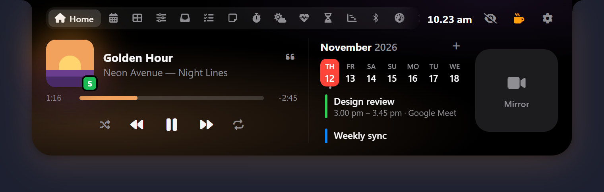

# Poni

An interactive notch for Windows 10 and 11, like Dynamic Island, with a Mac-style Dock. Beta for Mac and Linux. Free, no ads, no account.

  
  
  

Poni lives at the top of your screen (it used to be called "Notch for Windows"): hover over it to open it, drag files onto it, or press `Alt+N`.

**[Download the latest version](https://github.com/liimalim/Poni/releases/latest)**: pick `Poni_x.y.z_x64-setup.exe` (recommended, updates itself) or the portable `.exe`. Website: **[poni.web.id](https://poni.web.id/)**. How to use every feature: **[the Poni guide](https://poni.web.id/en/guide/)**.

**Mac and Linux (Beta)**: get the `.dmg`, `.AppImage` or `.deb` from **[poni.web.id/unduh/mac-linux](https://poni.web.id/unduh/mac-linux/?lang=en)** (free, or pay what you want). Some Windows-only parts (the Dock, Snap Zones, the Wi-Fi and Bluetooth lists and a few more) aren't there yet.

If Poni is useful to you, a ⭐ on this repo helps other people find it.

## Highlights

- **Music**: album art, a live visualizer and lyrics that follow the song, even inside the closed notch
- **Dock**: can stand in for the taskbar, with magnifying icons, five styles and windows that come out of their icon
- **At a glance**: Windows notifications, meetings, prayer times and to-dos with a countdown in the closed notch
- **Shelf**: drop files on Poni to zip, convert or share them, plus a clipboard history and files from your phone
- **AI Chat** with Gemini, Claude, any OpenAI-compatible API or Ollama, which can add reminders and notes for you
- **Buddy**: a 3D cat, dog or owl that watches your mouse and dozes off when you leave
- **Your look**: black, any color, glass or frosted glass, at the top edge or floating below it

## All features

Show every feature

- **Music**: album art with color glow, live visualizer, and controls for any player in the Windows media controls (Spotify, browsers and more) and VLC, plus **lyrics** that follow the song (from LRCLIB, off until you turn them on), right inside the closed notch if you like, with Korean, Japanese and Chinese lyrics in Latin letters or translated, a search to pick the right lyrics yourself, and a song progress bar
- **Dashboard**: weather, quick toggles (Wi-Fi, Bluetooth, keep awake, dark mode, mute mic, lock), app launcher, day progress, prayer times
- **Control**: like Windows Quick Settings, with Wi-Fi and Bluetooth lists, toggles, brightness and volume sliders, and picking the sound output and microphone
- **Calendar**: Google Calendar, Outlook or any iCal (.ics) link, with meeting reminders in the notch, a Calendar tab with a month view, and event details with a Join button
- **Todo** with due times you can type in everyday words (Indonesian or English), repeating tasks, snooze, and a countdown in the closed notch where you can tick tasks off; late tasks can tick themselves off. **Notes** with flashcards (write `question :: answer` lines and study them), **Pomodoro** with a Timer of any length and a stopwatch, **Weather, Health** (water with reminders, breaks, breathing, 20-20-20 eye breaks)
- **Prayer times**: a Prayer Times tab and reminders for the five daily prayers with a countdown in the closed notch (the Kemenag RI schedule in Indonesia, your local authority elsewhere), and an adhan from your own recording
- **Dock**: a bar of your apps at the bottom with magnifying icons in one rounded shape, in five styles (Black, White, Clear Glass, Frosted Glass, Midnight), on one display or all of them. It can stand in for the Windows taskbar with a Start and a Task View button, your other apps' tray icons (left and right click), a keyboard language menu, the time and status, the next prayer and a Show desktop button, lists an app's windows when you rest the mouse on it, opens files you drop on an app's icon with that app, can end a frozen app from its menu, and can come up while you're idle (off until you turn it on)
- **FPS counter** for games, with CPU and GPU, in the closed notch (off until you turn it on; Windows asks for permission once)
- **Wi-Fi & Bluetooth**: radio switches, join Wi-Fi networks right in Poni, connect/disconnect headphones and speakers, device battery levels
- **Screen Time, Day Progress, System stats** with CPU and GPU load and temperatures (when Windows shares them, no admin or driver needed), and a System summary that pops up in the closed notch now and then
- **Shelf and Drop Actions**: zip, extract, convert images, copy/move, OneDrive, Share, Recycle Bin, and a **clipboard history** of the texts, links and pictures you copy, with pins (off until you turn it on), and files and text from your **phone** on the same Wi-Fi with a QR code
- **Snap Zones**: drag a window onto the notch to tile it
- **Teleprompter**: your script scrolls in a strip right under the camera, with the line being read lit up; pause, speed and back one line from any app with keyboard shortcuts (off until you turn it on)
- **World clock**: up to 8 places with a meeting planner, a Dashboard widget and a slot in the closed notch, plus a clock size setting and an hourly chime
- **Moving wallpaper**: a video or picture behind your desktop icons, paused over fullscreen apps and on battery; a **color picker** for anything on the screen, and an **internet speed test**
- **Your look**: Poni in black, any color, glass, or frosted glass, attached to the top edge or floating a little below it
- **The closed notch**: pick what its left and right show (weather, battery, date, next prayer, event, task, temperature, CPU, memory, disk or Wi-Fi), a clock in the middle that stays while music plays, **auto-hide** (always, or while the apps you pick are in front) that can come down while you're idle, a hide button (or a double right-click) that tucks Poni away to a thin handle, or Poni stepping aside when the mouse comes to it from below; it slides away when an app goes fullscreen
- **Touchscreen support**: taps on Poni reach Poni, taps beside it go to the window behind
- **Windows notifications in Poni**: messages, mail and browser notifications stack under the closed notch, each for as long as you choose, and a click opens the app; a history keeps them for a few days, they follow Do not disturb, and Poni can turn off Windows' own pop-up so they don't show twice
- **Buddy**: a 3D cat, dog or owl under Poni that watches your mouse, bobs along to music and dozes off when you leave; click it to chat. On from the start, with five colors each, or put your own picture (even a GIF) in its place, and drag it anywhere on the screen
- **Cute cursors**: cat-themed mouse pointers in every app (a paw arrow, a paw for links, a ball of yarn while loading) in seven colors, or your own cursor pack; Windows' own come back when you turn them off
- **HUD** for volume, brightness, Caps Lock / Num Lock, airplane mode, the microphone and the touchpad; Poni can hide Windows' own brightness pop-up and your laptop maker's boxes while it shows the same thing
- **AI Chat** and **Translate** with Google Gemini (free API key from Google AI Studio), Claude, any OpenAI-compatible API, or local Ollama. AI Chat knows your day and how your PC is doing, can add todos, reminders, notes and calendar events, start Pomodoro or the stopwatch, play or pause your music, set the volume or open your apps, with Undo, can search the web (Google Search through Gemini, or a free Tavily key with any provider) and link its sources, and can send you a brief on the days and times you pick
- **AI usage**: your Claude and Codex plan limits in a tab, set against the time left until they reset, with a ring in the closed notch and a warning near the limit (off until you turn it on)
- **Claude Code in the notch**: its permission requests, questions and "done" show under the notch, and you can answer them there (off until you install it in Settings)
- **Animations**: nine little effects, each with its own switch: a glowing outline for alerts, windows and Dock menus coming out of their Dock icon, stacked notifications, karaoke lyrics, confetti for a done day and more
- **Radio**: internet radio stations from Radio Browser, with favourites, right in Poni (off until you turn it on)
- **Bookmarks**: save links in your own categories; copy a link and save it in one click (off until you turn it on)
- **Languages**: English and Bahasa Indonesia (following Windows by default), French, Polish, Turkish and Ukrainian (downloaded when you pick them), right-to-left layouts, and [translation files](translations/) anyone can help with
- **Back up and restore** Poni's settings and data to move to another PC
- **GitHub** pull requests waiting for your review

## Updates

The installed (Setup) version checks this page for new versions and updates itself (Settings → About). Every update is signed, so Poni only installs files signed by the author. The portable version shows a notice instead.

Coming from Notch for Windows? Nothing to do: Notch updates itself to Poni, removes the old install and keeps your settings, todos and notes.

## Support

Poni is free. If it helps you, you can treat the developer to a coffee:

- **[Support on PayPal](https://paypal.me/bosdigital)** (international)
- **QRIS** (Indonesia: GoPay, OVO, DANA, ShopeePay, mobile banking)

  

No coffee money right now? A ⭐ on this repo is free and helps just as much.

In Poni, click the cup button next to the settings gear (or open Settings → About). Made by **Alim AJ** · Bos Digital.

## Requirements

Windows 10/11 64-bit with Microsoft Edge WebView2 (already included in Windows 11 and up-to-date Windows 10).

Listing Wi-Fi networks needs location access for desktop apps on Windows 11 (Settings → Privacy & security → Location); Poni shows a button for it.

Windows SmartScreen may warn on first run because the app isn't code-signed with a paid certificate: click **More info → Run anyway**.

## Privacy

Everything stays on your PC (`%APPDATA%\Poni`). Network is only used for these: weather (Open-Meteo, on from the start), prayer times (api.myquran.com in Indonesia, Aladhan elsewhere), your calendar links, GitHub, AI chat and translation (the provider you pick), AI Chat's web searches (only the search words: to Google through the Gemini API when Gemini is your AI Chat provider, else to Tavily with your own key), the name of the place when you click Detect my location (BigDataCloud, from your rounded position), lyrics (LRCLIB, if you turn them on) and album art Windows doesn't give (Deezer), radio stations (Radio Browser, if you turn the Radio tab on), the title and icon of a link you bookmark, and update checks. Once a day the update check adds one to that day's usage count on poni.web.id, counted by country as Cloudflare reports it, and that's all (no ID for your PC, no version or language; only today's numbers are kept, no IP addresses) so we know how many people use Poni and where; turn it off in Settings → About and updates are checked on GitHub directly. AI chats and the clipboard history stay on this PC, the notification history is kept encrypted on this PC, Windows notifications shown in Poni, the Dock's tray icons and the FPS counter's frame counts are read on this PC and never sent anywhere, AI usage reads Claude Code's sign-in and Codex's logs on this PC and asks Anthropic only for your usage numbers, Claude Code's requests go to Poni on this PC only, files from your phone travel over your own Wi-Fi only, and the optional VLC web interface is only reached on this PC.

## What's new

What changed in every version: **[release notes](https://poni.web.id/en/release-notes/)** ([Bahasa Indonesia](https://poni.web.id/catatan-rilis/)).

---

**Bahasa Indonesia:** Poni adalah notch interaktif di bagian atas layar Windows (dulu bernama Notch for Windows). Unduh **Setup** dari [Releases](https://github.com/liimalim/Poni/releases/latest) supaya Poni bisa update otomatis. Cara pakai semua fiturnya ada di [Panduan Poni](https://poni.web.id/panduan/). Kalau Poni bermanfaat, kamu bisa traktir developernya lewat QRIS di atas.
